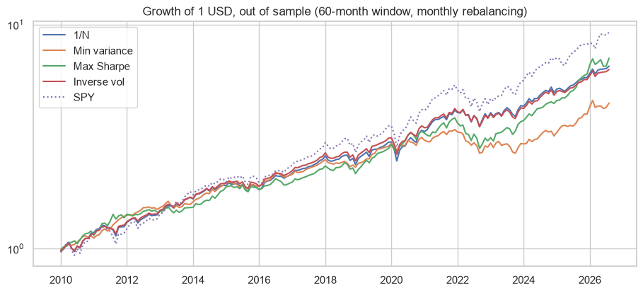
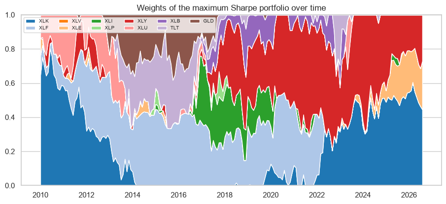

# Portfolio optimisation out of sample: Markowitz vs 1/N

I check if Markowitz (minimum variance and maximum Sharpe) beats an equal-weight portfolio when we do it like in real life: estimate with the last 60 months and invest the next month. Then I explain the returns with the Fama-French factors.

## Data
Monthly returns of the 9 sector SPDR ETFs, TLT and GLD (Yahoo Finance). Fama-French 3 factors + momentum (Kenneth French Data Library). 2005 to 2026.

## What I did
- Efficient frontier with all the sample (long only, scipy)
- Walk-forward backtest 2010-2026 of 1/N, minimum variance, maximum Sharpe and inverse volatility
- Fama-French + momentum regressions with Newey-West errors

## Main results
| Strategy | Return | Volatility | Sharpe | Max drawdown |
|---|---|---|---|---|
| 1/N | 11.9% | 11.6% | 0.91 | -17.7% |
| Min variance | 9.4% | 9.0% | 0.89 | -21.7% |
| Max Sharpe | 12.5% | 11.2% | 0.99 | -27.0% |
| Inverse vol | 11.7% | 10.8% | 0.95 | -17.1% |

- Max Sharpe wins a little but with the worst drawdown and very unstable weights.
- Gold is the only asset with a significant alpha against the equity factors (+8.7% per year).




## How to run

```
pip install -r requirements.txt
jupyter notebook portfolio_optimization.ipynb
```

---
Alejandro Lezcano Osorio | Universidad EIA (Colombia) and Rennes School of Business (France)
